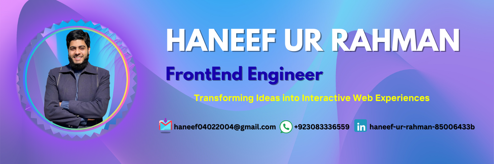

<!-- ═══════════════════════════════════════════════════════════════════════ -->
<!--                        HANEEF UR RAHMAN — PORTFOLIO                      -->
<!-- ═══════════════════════════════════════════════════════════════════════ -->

 

 

<!-- Status -->

  

<!-- Profile views + followers + stars -->

  

<!-- Social links -->

 

---

<!-- ═══════════════════════════════════════════════════════════════════════ -->
<!--                                ABOUT ME                                 -->
<!-- ═══════════════════════════════════════════════════════════════════════ -->

## 👨‍💻 About Me

<table>
<tr>
<td width="55%" valign="top">

> **I turn ideas into clean, working products.**

I'm a **Front-End Engineer** and **MERN Stack Developer** from Peshawar, Pakistan — currently pursuing **BS Computer Science** at the **University of Peshawar** (CGPA: 3.66/4.00, graduating 2026).

I love building tools that solve real problems — from campus library systems to welfare platforms. My approach: **clean code, thoughtful design, seamless UX**.

**What I'm up to:**
- 🔭 Building **BiblioTrack** — a Smart Library Management System
- 🌱 Exploring **Cloud Computing**, **AWS** & **Applied ML (NLP)**
- 💼 Recently worked as **Web Developer** @ Digital Empowerment Network
- 🤝 Open to **freelance**, **internships** & **open-source**
- 💬 Ask me about **React, TypeScript, Tailwind, MERN**

</td>
<td width="45%" valign="top">

### ⚡ Quick Facts

| | |
|:---|:---|
| 🎯 **Focus** | Frontend / Full-stack |
| 🏫 **Study** | BS CS @ UoP |
| 📅 **Graduating** | 2026 |
| 🏆 **Achievement** | PMYLS Laptop 2025 |
| 🥈 **Runner-up** | Entrepreneurship 2025 |
| 🌐 **Languages** | Pashto · Urdu · English |

 

**Currently Learning**

</td>
</tr>
</table>

---

<!-- ═══════════════════════════════════════════════════════════════════════ -->
<!--                               TECH STACK                                -->
<!-- ═══════════════════════════════════════════════════════════════════════ -->

## 🛠️ Tech Stack

**Frontend**

  

**Backend & Database**

  

**Cloud, Tools & Design**

 

`REST APIs` • `JWT Auth` • `Firebase Auth` • `Firestore` • `Agile / SCRUM` • `Version Control` • `Responsive Design`

---

<!-- ═══════════════════════════════════════════════════════════════════════ -->
<!--                            FEATURED PROJECTS                            -->
<!-- ═══════════════════════════════════════════════════════════════════════ -->

## 🚀 Featured Projects

*Things I've designed, coded & shipped. More on [GitHub →](https://github.com/Haneef-Ur-Rahman?tab=repositories)*

<!-- Project 1 — BiblioTrack -->
<table>
<tr>
<td width="100%">

### 📚 BiblioTrack — Smart Library Management System

> A full-stack digital library platform for the **CS Department, University of Peshawar** — bridging physical books and digital resources in one seamless system.

**✨ Key Features**
- 🔐 **Admin & Student portals** with secure session-based authentication
- 🔍 **Smart multi-criteria search** + first-come-first-served reservations
- 💰 **Automated fines** with **E-Challan** generation & **1-Bill** payment
- 🤖 **AI-powered chatbot** for library queries
- 📧 **Automated email notifications** for issuance, reservations & fines
- 📖 **Hybrid resource management** — physical books + digital PDFs

**🧰 Stack**

  

</td>
</tr>
</table>

<!-- Project 2 — Hassan Welfare -->
<table>
<tr>
<td width="100%">

### ❤️ Hassan Welfare Society Website

> A modern, responsive website for **Hassan Welfare Society** showcasing mission, vision, team members and contribution details.

**✨ Key Features**
- 🎯 Mission & vision presentation
- 👥 Organized member layout (executive + regular)
- 💝 Donation contribution details
- 📱 Fully responsive, mobile-first design
- 🔥 Deployed on Firebase Hosting

**🧰 Stack**

  

</td>
</tr>
</table>

<!-- Projects 3 & 4 -->
<table>
<tr>
<td width="50%" valign="top">

### 🛒 E-Commerce Platform

Full-stack e-commerce platform with secure cart & checkout flow.

- 🛒 Secure cart & checkout
- 📱 Mobile-first responsive UI
- ⚡ Interactive UI with Bootstrap & JS

</td>
<td width="50%" valign="top">

### 🗄️ BackEnd Projects

A collection of server-side services & RESTful APIs.

- 🔌 RESTful API design
- 🗄️ MongoDB integration
- 🛡️ Auth & middleware

</td>
</tr>
</table>

<!-- Projects 5 & 6 -->
<table>
<tr>
<td width="50%" valign="top">

### 🌐 Personal Portfolio

My personal portfolio — clean, fast, fully responsive.

- 🎨 Modern UI design
- ⚡ Lightning fast
- 📱 Fully responsive

</td>
<td width="50%" valign="top">

### 🧪 Practice & Learning

TypeScript, JS & component-building exercises.

- 📘 TypeScript practice
- 🎯 CodeAlpha tasks
- 🌍 CountryInfoHub
- 🏗️ Build-practice repos

</td>
</tr>
</table>

---

<!-- ═══════════════════════════════════════════════════════════════════════ -->
<!--                         EXPERIENCE & JOURNEY                            -->
<!-- ═══════════════════════════════════════════════════════════════════════ -->

## 💼 Experience & Journey

<table>
<tr>
<td width="30%" valign="top"><b>💼 Web Developer</b> <i>Jul 2025 – Sep 2025</i></td>
<td width="70%" valign="top">
<b>Digital Empowerment Network</b> 
Built responsive UIs with React & Tailwind · Developed backend services with Node/Express/MongoDB · Integrated Firebase auth · Agile/SCRUM team workflow
</td>
</tr>
<tr>
<td width="30%" valign="top"><b>👑 Management Lead</b> <i>Feb 2026 – Present</i></td>
<td width="70%" valign="top">
<b>Wrapify Labs, UOP Chapter</b> 
Lead team for university chapter events · Manage planning, logistics & execution of workshops & competitions
</td>
</tr>
<tr>
<td width="30%" valign="top"><b>🎪 Event Committee</b> <i>Feb 2025 – Present</i></td>
<td width="70%" valign="top">
<b>CSSC — Computer Science Students Club</b> 
Organized workshops, hackathons & coding events · Assisted in planning technical sessions
</td>
</tr>
<tr>
<td width="30%" valign="top"><b>🤝 Lead Volunteer</b> <i>Aug 2024 – Present</i></td>
<td width="70%" valign="top">
<b>Saylani Welfare International Trust</b> 
Coordinated volunteer teams · Managed community food distribution initiatives
</td>
</tr>
<tr>
<td width="30%" valign="top"><b>🎓 BS Computer Science</b> <i>2022 – 2026 · CGPA 3.66/4.00</i></td>
<td width="70%" valign="top">
<b>University of Peshawar</b> 
Web technologies · Software engineering · Databases · Applied ML (NLP, beginner)
</td>
</tr>
</table>

---

<!-- ═══════════════════════════════════════════════════════════════════════ -->
<!--                             GITHUB STATS                                -->
<!-- ═══════════════════════════════════════════════════════════════════════ -->

## 📊 GitHub Analytics

 

 

 

---

<!-- ═══════════════════════════════════════════════════════════════════════ -->
<!--                              CONTACT                                    -->
<!-- ═══════════════════════════════════════════════════════════════════════ -->

## 📫 Let's Build Something Great Together

 

> 💬 Have a project, a role, or just want to say hi?  
> I'm always open to interesting conversations and new opportunities.

 

  

  

  

---

### ⭐ From [Haneef Ur Rahman](https://github.com/Haneef-Ur-Rahman) — Thanks for visiting my profile!

